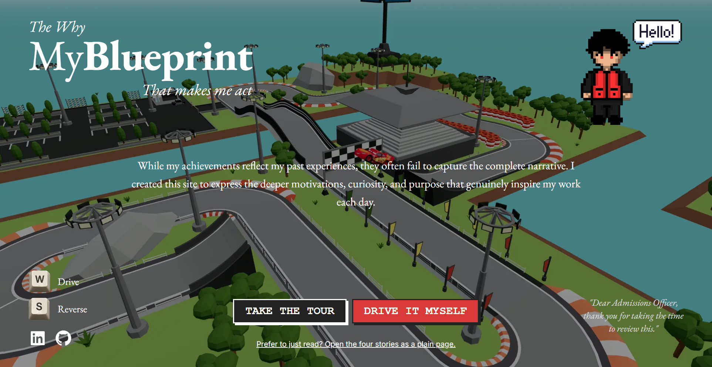
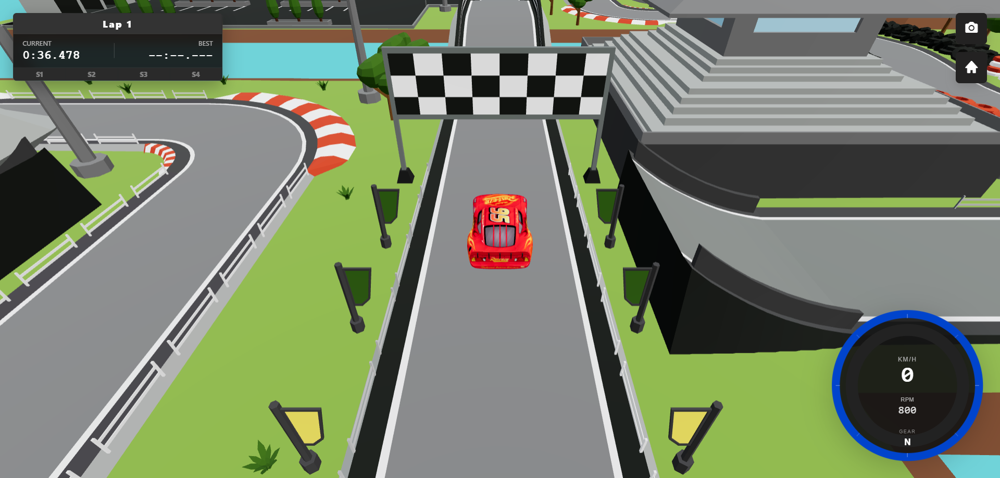

  <h1>🏎️ Adrián Garrido - MyBlueprint</h1>
  
<i>An interactive, low-poly 3D web application designed for college admissions.</i>

  
  

 

  

---

## 💡 Core Concept

Using a racing telemetry interface, the project organizes academic work, mathematics research, software development, and community leadership across four track sectors instead of a standard portfolio list.

  

## 🏁 Design Philosophy

Built around personal interests and daily motivations. The interface adapts Formula 1 telemetry styling for the heads-up display, while the vehicle model features Lightning McQueen, connecting technical craft directly with personal interests.

## 🛠️ Technologies Used

  
  
  
  
  

## ⚙️ Technical Architecture

* **3D Engine:** Three.js (Vanilla JS) rendering low-poly 3D assets optimized for browser performance.
* **Controls & Navigation:** Spline mechanics (`CatmullRomCurve3`) mapped to `W/S` and Arrow keys for consistent track movement.
* **Camera Modes:** Dual-camera setup supporting Third-Person Follow Mode, Orbit Inspection Mode, and a Free Drone Mode.
* **Frontend UI:** HUD overlay rendering simulated velocity, sector progress, and content modals on demand.

---

## 📄 License

This project is licensed under the MIT License - see the [LICENSE](LICENSE) file for details.
